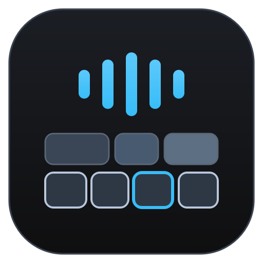
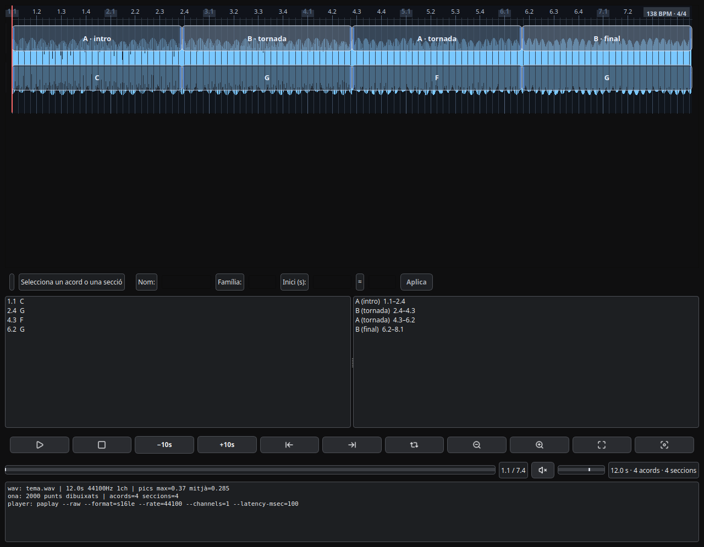

# PROJECTE AUTO CHORDS

  

**AUTO CHORDS** és una aplicació d'escriptori (**Linux · Windows · macOS**) que
**analitza una cançó i n'extreu els acords i l'estructura**. Els pots **revisar i
editar** en un visor d'estil DAW i **exportar el resultat com a clips WAV
silenciosos** —un per **acord** i un per **secció**, amb **el nom de l'acord al
fitxer**— llestos per **arrossegar-los ordenats en una sola pista a qualsevol DAW**
(Live, Reaper, Logic, Bitwig, Studio One, Pro Tools, Cubase…). Opcionalment genera
també la **partitura de xifrats** (MusicXML; PDF/MSCZ si tens MuseScore).

També permet **editar els extrems de la còpia WAV de treball** dins d'un
projecte, sense haver d'analitzar acords: retallar-los o afegir-hi silenci amb
nanses, previsualització i desfer/refer. El silenci afegit es marca «N» (sense
acord); les seccions es mantenen. També pots **exportar la còpia editada** a
WAV, MP3, FLAC, AAC/M4A, OGG o Opus des de `Fitxer ▸ Exporta àudio…`. L'abast
acordat és a [`docs/REGLES_DE_LA_APP.md` §13.9](docs/REGLES_DE_LA_APP.md).

> **Novetats de la v9.0.0 — checkpoint «mapa de temps resolt»** — els clips
> de BPM/compàs es validen per **beats sencers** de la graella del Snap (QM o
> BPM/compàs) · fronteres interiors a la graella, amb inici del primer clip i
> final de l’últim lliures · **1/4 vàlid a tota l’app** · `+` sempre al beat
> QM més pròxim · ajust que prioritza conservar el BPM i canviar el compàs ·
> botó explícit **Ajusta BPM al compàs** per forçar compassos sencers ·
> **rubato**, detecció de BPM per tram, tap tempo, marcadors i quantització
> conservats. Historial complet: [`CHANGELOG.md`](CHANGELOG.md).

> ⚠️ **Beta:** una versió nova pot rebutjar un projecte vell amb un missatge
> clar. L'app no modifica ni esborra mai el projecte rebutjat. Detall:
> [`AGENTS.md`](AGENTS.md).

  

👉 **Portal de projectes:** [pepelocotango.github.io](https://pepelocotango.github.io)

---

## 📥 Descarrega i instal·la

Tot és a **➡️ [Releases](https://github.com/Pepelocotango/PROJECTE-AUTO-CHORDS/releases)**
(els noms són `AutoChords-<versió>-build<NN>-linux-x86_64.tar.gz` · `…-win-x64.zip` · `…-macos-x86_64.dmg`).

| SO | Paquet | Com s'instal·la |
|----|--------|-----------------|
| 🐧 **Linux** (x86_64) | **`.tar.gz`** (conté l'**AppImage**) | `tar -xzf AutoChords-*-linux-x86_64.tar.gz` → `chmod +x AutoChords-*.AppImage` → `./AutoChords-*.AppImage` (o **doble clic**). **No cal instal·lar res** (ni Python, ni `libfuse2`). |
| 🪟 **Windows 10/11** (x64) | **`.zip`** portable | Descomprimeix en una carpeta i executa **`AutoChords.exe`**. Si SmartScreen avisa: *Més informació ▸ Executa igualment*. **No cal instal·lar res** (runtime a dins). |
| 🍎 **macOS** (10.13 High Sierra o +) | **`.dmg`** | Obre el `.dmg` i arrossega **`AUTO_CHORDS.app`** a **Applications**. Al primer cop: **clic dret ▸ Obre** (o `xattr -dr com.apple.quarantine AUTO_CHORDS.app`). |

> 🎧 **Per ESCOLTAR**: a **Linux** cal **PipeWire** o **PulseAudio**; a **Windows/macOS**
> l'àudio va amb el sistema (PortAudio). Sense àudio, l'app fa tota la resta (analitzar,
> editar, exportar) — només avisa que no pot sonar.
>
> 🎼 **Partitura**: **MusicXML sempre**; **PDF i MSCZ només si tens [MuseScore](https://musescore.org)**
> instal·lat (en aquest projecte s'ha provat amb **MuseScore 4.6.x**; el 4.7+ no hi va).
>
> 📄 **Build, CI i validació**: [`DEVELOPING.md`](DEVELOPING.md).

## 🚀 Flux de treball (5 passos)

1. **Obre l'àudio** (`Fitxer ▸ Obre…`, `Ctrl+O`, o **arrossegant-lo** des de l'explorador de fitxers) — si no és WAV, es converteix sol amb **ffmpeg** i en queda una còpia dins el projecte. En obrir-lo es crea/obre el **projecte** (et demana la carpeta si cal).
2. **Opcional: ajusta el temps i analitza** — **Analitza BPM** (`F7`) per a BPM/beats i **Analitza** (`F5`) per a acords + estructura, en l'ordre que vulguis. També pots treballar a mà des del model inicial (1 acord `N` + 1 secció `A`). **L'anàlisi i l'edició manual són complementaris**: l'anàlisi proposa i tu corregeixes, o al revés, fins al mapa final.
3. **Revisa i edita** els acords, les seccions i el **mapa de BPM/compàs** al visor (timeline estil DAW amb **tres pistes**, llistes i franja Editor).
4. **`Exporta WAV's…`** (`Ctrl+E`): WAVs silenciosos, CSV, `mapa_tempo/`, guia i, si vols, **`Exporta partitura`**. Per a una còpia en un altre format, **`Fitxer ▸ Exporta àudio…`**.
5. **Desa el projecte** (`Ctrl+S`): `.acproj` + `audio/` + CSV + backups. Els **CSV del model es desen a cada edició**; `Ctrl+S` desa el document i el backup, i l'autosave/recuperació són automàtics.

## 🎛️ Què fa

- **Importa** WAV, MP3, FLAC i **16 formats més** (vegeu [§ Formats](#-formats-dàudio-acceptats)) convertint-los amb `ffmpeg`. També pots **arrossegar la cançó des de l'explorador de fitxers** directament sobre la finestra (Windows, macOS i Linux).
- **Analitza** (`F5`) els acords amb **Chordino** (NNLS-Chroma) i l'estructura amb **qm-segmenter** (Queen Mary), tots dos **dins l'app** (Vamp). El BPM té una acció separada, **Analitza BPM** (`F7`).
- **Analitza BPM** amb motors **nostre** o **Queen Mary**, sensibilitat ajustable 0–100 i línies de **beats/downbeats** sobre l'ona; el mode per defecte és **només beats** (sense BPM, compàs ni downbeats). Després del play, **Ajusta la graella als beats QM** snapeja els marcadors de compàs i recalcula el BPM; `+` continua creant compàs + secció.
- **Timeline estil DAW** amb **tres pistes**: **acords**, **estructura** i **BPM/compàs** (mapa de tempo per trams). Ona, regle, cursor, zoom; mode **BPM · compàs** o **Lliure (hh:mm:ss)**; graella fixa de **temps absolut hh:mm:ss** sota l'ona, independent del tempo; metrònom; loop A/B. El BPM es pot mostrar en **negra**, **negra amb punt**, **corxera** o **blanca** (per exemple, `55` amb punt = `82.5` negres/min), i el metrònom pot clicar en eixa unitat o en el denominador del compàs; les subdivisions que no caben en algun compàs es bloquegen.
- **Edició completa** de les tres pistes: **moure/partir/duplicar/redimensionar** acords i seccions, i **moure/partir/duplicar** els **trams de tempo**; **multi-selecció** (`Ctrl`/`Shift+clic`), **copiar/retallar/enganxar**, **desfer/refer** (`Ctrl+Z`/`Ctrl+Y`). Les tres comparteixen les mateixes eines (regla d'or #11).
- **Quantitza BPM** a 1 decimal (`BPM 0,1`): conserva barres enteres de cada clip, recalcula finals i desplaça els inicis posteriors; els rubatos no es quantitzen.
- **Exporta clips WAV silenciosos** ordenats i nomenats per acord (`1-1-1_C.wav`) i per secció (`1-1-1_3-2-1_A.wav`) → els arrossegues al teu DAW i hi tens l'harmonia marcada.
- **Exporta el mapa de tempo** a `mapa_tempo/` (`mapa_tempo.csv`) i una **guia d'acords** (`guia_acords.html`) per imprimir. La partitura MusicXML conserva la unitat de tempo triada (`negra`, `negra amb punt`, `corxera` o `blanca`).
- **Rubato**: selecciona un rang A–B o un clip del carril de BPM/compàs i marca’l com a rubato; l’app deriva BPM i compassos, conserva els segons i identifica la graella exportada com a aproximada (`mapa_tempo/AVIS_APROXIMACIO.txt` i text al MusicXML).
- **Projectes autocontinguts** («com un DAW»): en obrir un WAV, l'app pot crear una **carpeta que ho conté tot** (`.acproj` + còpia de l'`audio/` + CSVs + `backup/`); **Obre projecte / Obre recent**, **Desa** (`Ctrl+S`), **Desa com…**, **autosave** cada 60 s i **recuperació** si l'app cau. Detall: `app/projecte.py`.
- **Edició d'àudio bàsica**: nanses per retallar els extrems o afegir-hi silenci a la còpia del projecte, amb snap commutable, previsualització i desfer/refer sincronitzat amb el model; l'original queda intacte. **`Exporta àudio…`** desa la còpia editada a WAV (16/24/32 bits), MP3, FLAC, AAC/M4A, OGG o Opus, amb els perfils que el `ffmpeg` del paquet sap escriure; vegeu [`docs/REGLES_DE_LA_APP.md` §13.9](docs/REGLES_DE_LA_APP.md).
- **Partitura de xifrats**: MusicXML sempre; PDF/MSCZ amb MuseScore.
- La interfície (menús, barres, dreceres) és a [`docs/ESQUEMA_UI.md`](docs/ESQUEMA_UI.md).

## 💻 Requisits

### ✅ Usuari final (els 3 paquets)

| SO | Sistema | CPU | RAM / disc | Llibreries | Paquet |
|----|---------|-----|-----------|-----------|--------|
| 🐧 **Linux** | **x86_64** amb **glibc ≥ 2.35** (Ubuntu 22.04+, Debian 12+, Fedora 36+…) | x86_64 amb **SSE2** | ~1 GB RAM · ~170 MB | **Cap** — tot a dins. Per escoltar: **PipeWire/PulseAudio** | `.tar.gz` (runtime estàtic: **no cal `libfuse2`**) |
| 🪟 **Windows** | **10 o 11 x64** | x86_64 amb **SSE2** | ~1 GB RAM · ~170 MB | **Cap** (runtime a dins) | `.zip` portable |
| 🍎 **macOS** | **10.13 High Sierra o posterior** (Intel x86_64) | x86_64 amb **SSE2** | ~1 GB RAM · ~180 MB | **Cap** (frameworks a dins) | `.dmg` |

> ✨ **No cal instal·lar res més**: ni Python, ni Qt, ni ffmpeg, ni els plugins — tot va **dins** el paquet.
> 💡 **CPU antiga**: provada en un **Core 2 Quad Q9400 sense AVX** ✅ (per això `numpy < 2` és obligatori i el `minos` de macOS es fixa a 10.13).
> ⚠️ **Fitxers llargs**: el visor carrega **tot el PCM a memòria** (≈3× la mida del fitxer; una hora ≈ 2 GB). A partir de **45 min** l'app t'ho avisa pel log.

### 🛠️ Des del codi (desenvolupament)

- **Python 3.10+** + **PyQt5** + **numpy < 2** → o, més fàcil: `bash instal·la_local.sh` (crea `.venv/` + les dependències, **sense `sudo`**) i `./AUTO_CHORDS.sh`.
- **Host Vamp propi** (`eines/vamp_host.cpp`, compilat a `vamp_host_local`) + els **plugins Vamp** dins el projecte (Chordino i Queen Mary).
- **`ffmpeg`** (opcional, només per importar formats que no siguin WAV).

Els requisits de **build** (compilador, SDK, llibreries natives, `appimagetool`) i tot el
procés són a **[`DEVELOPING.md`](DEVELOPING.md)** i a `.github/workflows/`.

## 📚 Documentació

| Document | Què hi trobaràs |
|---|---|
| [`docs/README.md`](docs/README.md) | **Índex** de tota la documentació |
| [`docs/REGLES_DE_LA_APP.md`](docs/REGLES_DE_LA_APP.md) | **Invariants** del producte |
| [`DEVELOPING.md`](DEVELOPING.md) | Entorn, build i CI |
| [`CHANGELOG.md`](CHANGELOG.md) | Historial de versions |

## 🎼 Formats d'àudio acceptats (importació actual)

L'app treballa amb **WAV PCM 16 bits** internament, però `Obre…` accepta **19 formats**
i els converteix automàticament amb **ffmpeg** (vegeu `app/ffmpeg.py`):

`WAV` · `MP3` · `AIFF`/`AIF`/`AIFC` · `FLAC` · `M4A` · `AAC` · `OGG`/`OGA` · `Opus` ·
`WMA` · `MP2` · `CAF` · `W64` · `AU` · `WV` · `APE` · `ALAC`

En obrir un àudio, el projecte desa la WAV PCM 16 bits a `audio/`: si cal,
converteix l'original directament en un temporal dins del projecte, sense crear
`<nom>_convertit.wav` al costat de l'original. L'original no es modifica. La
retallada dels extrems i l'exportació de la còpia editada (WAV, MP3, FLAC,
AAC/M4A, OGG o Opus) ja estan implementades. Vegeu
[`docs/REGLES_DE_LA_APP.md` §13.9](docs/REGLES_DE_LA_APP.md).

## 👤 Autoria

**Autor:** **Pëp** — [pepelocotango@gmail.com](mailto:pepelocotango@gmail.com)

Aquest projecte s'ha desenvolupat **en col·laboració amb agents i assistents
d'intel·ligència artificial**, que hi han dedicat moltes hores de feina. Volem
reconèixer-ho explícitament:

- 🤖 **[opencode](https://opencode.ai)** (agent `OC`) — el gruix del desenvolupament
  d'aquesta darrera etapa: l'**AppImage autocontinguda**, els **workflows de GitHub
  Actions** (build + release), els **plugins Vamp de Queen Mary**, l'**host Vamp propi**,
  les **icones professionals**, la coherència del play i bona part de la resta. Amb
  models com **DeepSeek** (que va fer una feinada enorme 💙), **Claude** i **Gemini**.
- 🧠 **[Claude](https://claude.ai)** (Anthropic) — també hi ha ajudat.
- ✨ **[Gemini](https://gemini.google.com)** i **[Google AI Studio](https://aistudio.google.com)** (agent `GM`)
- 🧭 **Devin** (agent `DV`) · 💬 **[Chatbox](https://chatboxai.app)** (agent `CB`)
- 🛠️ **[VS Code](https://code.visualstudio.com)** amb **[GitHub Copilot](https://github.com/features/copilot)** (agent `VS`)
- 🌊 **[Windsurf](https://windsurf.com)** amb el model **SWE** (agent `WS`) · ⚡ **Spark** (`SPARK`, primeres versions)

> **Nota legal**: els sistemes d'IA no són titulars de drets d'autor (UE/EUA); la
> **titularitat i la responsabilitat del projecte són de l'autor humà**. El
> reconeixement de dalt és, per tant, un **agraïment honest**, no una atribució jurídica.

## 📜 Agraïments i llicències de tercers

Aquest projecte depèn de treballs previs d'altres persones i equips. **El detall
complet de components, llicències i autoria és a
[`LLICENCIES_TERCERS.md`](LLICENCIES_TERCERS.md).** Les icones de la UI són de
**Lucide** (ISC) i algunes deriven de **Feather** (MIT); el text és a
[`icones/LICENSE`](icones/LICENSE).

Sense aquest ecosistema, aquest projecte no seria possible. Els agraïments i el
reconeixement formal són part de la forma de treball i del respecte que es mereixen
les eines i els desenvolupadors que ens han donat base i inspiració.

## Llicència

**GPL-3.0-or-later** (GPLv3 o posterior) — vegeu [`LICENSE`](LICENSE).
Copyright (c) 2026 Pëp <pepelocotango@gmail.com>.

-