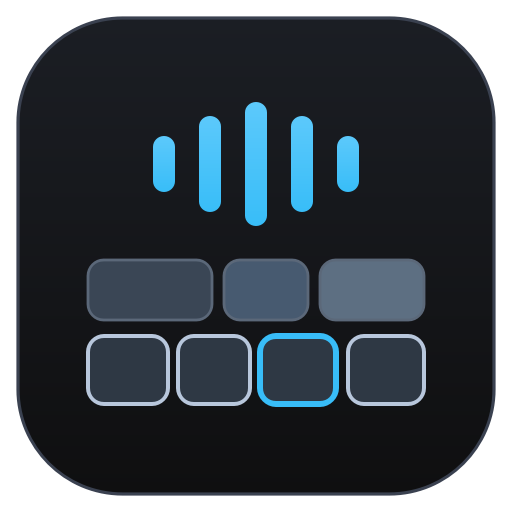
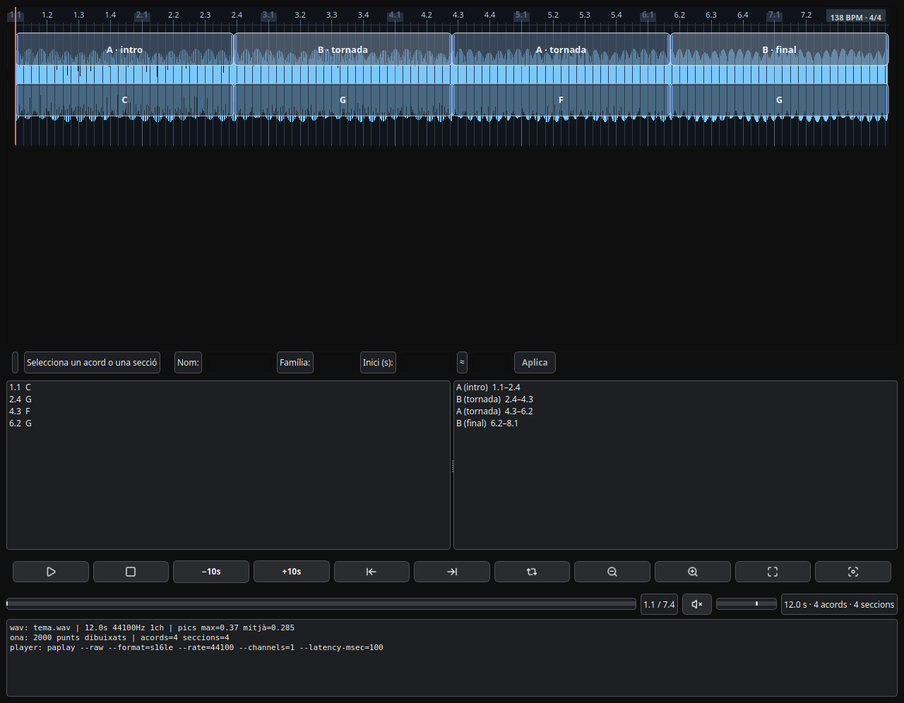

# PROJECTE AUTO CHORDS

  

**AUTO CHORDS** és una aplicació d'escriptori (**Linux · Windows · macOS**) que
**analitza una cançó i n'extreu els acords i l'estructura**. Els pots **revisar i
editar** en un visor d'estil DAW i **exportar el resultat com a clips WAV
silenciosos** —un per **acord** i un per **secció**, amb **el nom de l'acord al
fitxer**— llestos per **arrossegar-los ordenats en una sola pista a qualsevol DAW**
(Live, Reaper, Logic, Bitwig, Studio One, Pro Tools, Cubase…). Opcionalment genera
també la **partitura de xifrats** (MusicXML; PDF/MSCZ si tens MuseScore).

> **Novetats de la v0.7.0 (BETA)** — exportació **asíncrona** amb progrés ·
> **51 eines per a agents** (MCP) · **desat atòmic** dels CSV (mai un fitxer a mitges) ·
> **desfer/refer complet** (BPM, compàs, offset i loop) · **parteix una secció** ·
> **cursor del loop alineat amb el so**. Historial complet: [`CHANGELOG.md`](CHANGELOG.md).

  

👉 **Portal de projectes:** [pepelocotango.github.io](https://pepelocotango.github.io)

---

## 📥 Descarrega i instal·la

Tot és a **➡️ [Releases](https://github.com/Pepelocotango/PROJECTE-AUTO-CHORDS/releases)**
(els noms són `AutoChords-<versió>-build<NN>-linux-x86_64.tar.gz` · `…-win-x64.zip` · `…-macos-x86_64.dmg`).

| SO | Paquet | Com s'instal·la |
|----|--------|-----------------|
| 🐧 **Linux** (x86_64) | **`.tar.gz`** (conté l'**AppImage**) | `tar -xzf AutoChords-*-linux-x86_64.tar.gz` → `chmod +x AutoChords-*.AppImage` → `./AutoChords-*.AppImage` (o **doble clic**). **No cal instal·lar res** (ni Python, ni `libfuse2`). |
| 🪟 **Windows 10/11** (x64) | **`.zip`** portable | Descomprimeix en una carpeta i executa **`AutoChords.exe`**. Si SmartScreen avisa: *Més informació ▸ Executa igualment*. **No cal instal·lar res** (runtime a dins). |
| 🍎 **macOS** (10.13 High Sierra o +) | **`.dmg`** | Obre el `.dmg` i arrossega **`AUTO_CHORDS.app`** a **Applications**. Al primer cop: **clic dret ▸ Obre** (o `xattr -dr com.apple.quarantine AUTO_CHORDS.app`). |

> 🎧 **Per ESCOLTAR**: a **Linux** cal **PipeWire** o **PulseAudio**; a **Windows/macOS**
> l'àudio va amb el sistema (PortAudio). Sense àudio, l'app fa tota la resta (analitzar,
> editar, exportar) — només avisa que no pot sonar.
>
> 🎼 **Partitura**: **MusicXML sempre**; **PDF i MSCZ només si tens [MuseScore](https://musescore.org)**
> instal·lat (en aquest projecte s'ha provat amb **MuseScore 4.6.x**; el 4.7+ no hi va).
>
> 📄 **Guia de validació pas a pas** (checklist de 5 min): [`docs/PROVES_FUNCIONALS_3SO.md`](docs/PROVES_FUNCIONALS_3SO.md).

## 🚀 Ús en 4 passos

1. **Obre l'àudio** (`Fitxer ▸ Obre…`, `Ctrl+O`) — si no és WAV, es converteix sol amb **ffmpeg**.
2. **Ajusta el temps** (BPM amb **🎯 Detecta** o **TAP**) i fes **Analitza** (`F5`, obre el diàleg d'opcions).
3. **Revisa i edita** els acords i les seccions al visor (timeline estil DAW, llistes, franja Editor).
4. **`Exporta WAV's…`** (`Ctrl+E`) — i, si vols, **`Exporta partitura`**.

## 🎛️ Què fa

- **Importa** WAV, MP3, FLAC i **16 formats més** (vegeu [§ Formats](#-formats-dàudio-acceptats)) convertint-los amb `ffmpeg`.
- **Analitza** els acords amb **Chordino** (NNLS-Chroma) i l'estructura amb **qm-segmenter** (Queen Mary), tots dos **dins l'app** (Vamp).
- **Timeline estil DAW**: ona, regle, cursor, zoom; mode **BPM · compàs** o **Lliure (hh:mm:ss)**; metrònom; loop A/B.
- **Edició completa**: moure/partir/duplicar acords i seccions, **multi-selecció** (`Ctrl`/`Shift+clic`), **copiar/retallar/enganxar**, **desfer/refer** (`Ctrl+Z`/`Ctrl+Y`).
- **Exporta clips WAV silenciosos** ordenats i nomenats per acord/secció → els arrossegues al teu DAW i hi tens l'harmonia marcada.
- **Projectes autocontinguts** («com un DAW»): en obrir un WAV, l'app pot crear una **carpeta que ho conté tot** (`.acproj` + còpia de l'`audio/` + CSVs + `backup/`); **Obre projecte / Obre recent**, **Desa** (`Ctrl+S`), **Desa com…**, **autosave** cada 60 s i **recuperació** si l'app cau. Detall: [`docs/PROJECTES.md`](docs/PROJECTES.md).
- **Partitura de xifrats**: MusicXML sempre; PDF/MSCZ amb MuseScore.
- **Agents IA (MCP)**: l'app viva es pot controlar amb **51 eines** (analitzar, exportar, moure acords, etc.) des d'un agent compatible amb *Model Context Protocol*. Detall: [`docs/MCP_AUTO_CHORDS.md`](docs/MCP_AUTO_CHORDS.md).
- La interfície (menús, barres, dreceres) és a [`docs/ESQUEMA_UI.md`](docs/ESQUEMA_UI.md).

## 💻 Requisits

### ✅ Usuari final (els 3 paquets)

| SO | Sistema | CPU | RAM / disc | Llibreries | Paquet |
|----|---------|-----|-----------|-----------|--------|
| 🐧 **Linux** | **x86_64** amb **glibc ≥ 2.35** (Ubuntu 22.04+, Debian 12+, Fedora 36+…) | x86_64 amb **SSE2** | ~1 GB RAM · ~170 MB | **Cap** — tot a dins. Per escoltar: **PipeWire/PulseAudio** | `.tar.gz` (runtime estàtic: **no cal `libfuse2`**) |
| 🪟 **Windows** | **10 o 11 x64** | x86_64 amb **SSE2** | ~1 GB RAM · ~170 MB | **Cap** (runtime a dins) | `.zip` portable |
| 🍎 **macOS** | **10.13 High Sierra o posterior** (Intel x86_64) | x86_64 amb **SSE2** | ~1 GB RAM · ~180 MB | **Cap** (frameworks a dins) | `.dmg` |

> ✨ **No cal instal·lar res més**: ni Python, ni Qt, ni ffmpeg, ni els plugins — tot va **dins** el paquet.
> 💡 **CPU antiga**: provada en un **Core 2 Quad Q9400 sense AVX** ✅ (per això `numpy < 2` és obligatori i el `minos` de macOS es fixa a 10.13).
> ⚠️ **Fitxers llargs**: el visor carrega **tot el PCM a memòria** (≈3× la mida del fitxer; una hora ≈ 2 GB). A partir de **45 min** l'app t'ho avisa pel log.

### 🛠️ Des del codi (desenvolupament)

- **Python 3.10+** + **PyQt5** + **numpy < 2** → o, més fàcil: `bash instal·la_local.sh` (crea `.venv/` + les dependències, **sense `sudo`**) i `./AUTO_CHORDS.sh`.
- **Host Vamp propi** (`eines/vamp_host.cpp`, compilat a `vamp_host_local`) + els **plugins Vamp** dins el projecte (Chordino i Queen Mary).
- **`ffmpeg`** (opcional, només per importar formats que no siguin WAV).

Els requisits de **build** (compilador, SDK, llibreries natives, `appimagetool`) i tot el
procés són a **[`DEVELOPING.md`](DEVELOPING.md)** i **[`docs/ESTAT_MULTI_SO.md`](docs/ESTAT_MULTI_SO.md)**.

## 📚 Documentació

| Document | Què hi trobaràs |
|---|---|
| [`docs/README.md`](docs/README.md) | **Índex complet** de tota la documentació |
| [`DEVELOPING.md`](DEVELOPING.md) | Entorn, eines, flux de treball i com construir-ho |
| [`docs/REGLES_DE_LA_APP.md`](docs/REGLES_DE_LA_APP.md) | **Invariants** del producte («s'ha de complir sempre») |
| [`docs/ESQUEMA_UI.md`](docs/ESQUEMA_UI.md) | Esquema de la interfície (menús, barres, dreceres) |
| [`docs/PROJECTES.md`](docs/PROJECTES.md) | **Projectes autocontinguts** («com un DAW»): `.acproj`, «Desa com», autosave/backups i recuperació |
| [`docs/FLUX_DE_DADES.md`](docs/FLUX_DE_DADES.md) | **Flux de dades**: capa crua (`analisi/`, immutable) vs model editable; per què editar o el mode fàcil no destrueix l'anàlisi |
| [`docs/NOTACIO_XIFRAT.md`](docs/NOTACIO_XIFRAT.md) | **Notació del xifrat**: la **forma canònica** (`Am`→`A-`, `Cmaj7`→`CMaj7`, `Bø`→`B-7b5`) i on s'aplica (model, noms de fitxer, partitura) |
| [`docs/TIPUS_XIFRAT_ACORDS.md`](docs/TIPUS_XIFRAT_ACORDS.md) | **Catàleg de tipus d'acord**: variants de sintaxi, graus i `<kind>` MusicXML (per nivells + extres) |
| [`docs/ESTAT_MULTI_SO.md`](docs/ESTAT_MULTI_SO.md) | Com es construeixen i l'estat dels 3 paquets (Linux/Windows/macOS) |
| [`docs/MCP_AUTO_CHORDS.md`](docs/MCP_AUTO_CHORDS.md) | El pont **MCP** i les seves 51 eines |
| [`docs/CI_WORKFLOWS.md`](docs/CI_WORKFLOWS.md) | Els workflows de GitHub Actions (build + release) |
| [`CHANGELOG.md`](CHANGELOG.md) | Historial de versions |

## 🎼 Formats d'àudio acceptats

L'app treballa amb **WAV PCM 16 bits** internament, però `Obre…` accepta **19 formats**
i els converteix automàticament amb **ffmpeg** (vegeu `app/ffmpeg.py`):

`WAV` · `MP3` · `AIFF`/`AIF`/`AIFC` · `FLAC` · `M4A` · `AAC` · `OGG`/`OGA` · `Opus` ·
`WMA` · `MP2` · `CAF` · `W64` · `AU` · `WV` · `APE` · `ALAC`

El WAV de treball queda al costat de l'original com **`<nom>_convertit.wav`**
(es reutilitza si ja és més nou que l'original).

## 👤 Autoria

**Autor:** **Pëp** — [pepelocotango@gmail.com](mailto:pepelocotango@gmail.com)

Aquest projecte s'ha desenvolupat **en col·laboració amb agents i assistents
d'intel·ligència artificial**, que hi han dedicat moltes hores de feina. Volem
reconèixer-ho explícitament:

- 🤖 **[opencode](https://opencode.ai)** (agent `OC`) — el gruix del desenvolupament
  d'aquesta darrera etapa: l'**AppImage autocontinguda**, els **workflows de GitHub
  Actions** (build + release), els **plugins Vamp de Queen Mary**, l'**host Vamp propi**,
  les **icones professionals**, la coherència del play i bona part de la resta. Amb
  models com **DeepSeek** (que va fer una feinada enorme 💙), **Claude** i **Gemini**.
- 🧠 **[Claude](https://claude.ai)** (Anthropic) — també hi ha ajudat.
- ✨ **[Gemini](https://gemini.google.com)** i **[Google AI Studio](https://aistudio.google.com)** (agent `GM`)
- 🧭 **Devin** (agent `DV`) · 💬 **[Chatbox](https://chatboxai.app)** (agent `CB`)
- 🛠️ **[VS Code](https://code.visualstudio.com)** amb **[GitHub Copilot](https://github.com/features/copilot)** (agent `VS`)
- 🌊 **[Windsurf](https://windsurf.com)** amb el model **SWE** (agent `WS`) · ⚡ **Spark** (`SPARK`, primeres versions)

> **Nota legal**: els sistemes d'IA no són titulars de drets d'autor (UE/EUA); la
> **titularitat i la responsabilitat del projecte són de l'autor humà**. El
> reconeixement de dalt és, per tant, un **agraïment honest**, no una atribució jurídica.

## 📜 Agraïments i llicències de tercers

Aquest projecte depèn de treballs previs d'altres persones i equips. **El detall
complet de llicències és a [`LLICENCIES_TERCERS.md`](LLICENCIES_TERCERS.md).**

| Component | Llicència | Autoria |
|-----------|-----------|---------|
| **[Python](https://www.python.org)** | PSF-2.0 | Python Software Foundation |
| **[PyQt5](https://riverbankcomputing.com/software/pyqt)** / **[Qt5](https://www.qt.io)** | GPL-3.0 / LGPL-3.0 | Riverbank / The Qt Company |
| **[NumPy](https://numpy.org)** | BSD-3-Clause | NumPy Developers |
| **[Chordino / NNLS-Chroma](https://code.soundsoftware.ac.uk/projects/nnls-chroma)** | GPL-2.0+ | Matthias Mauch (C4DM, Queen Mary) |
| **[QM Vamp Plugins](https://github.com/c4dm/qm-vamp-plugins)** | GPL-2.0+ | Centre for Digital Music (Queen Mary) |
| **[Vamp Plugin SDK](https://github.com/c4dm/vamp-plugin-sdk)** | MIT / BSD-3 | C4DM |
| **[Sonic Annotator](https://github.com/sonic-visualiser/sonic-annotator)** | GPL-2.0+ | Chris Cannam / QMUL |
| **[FFmpeg](https://ffmpeg.org)** | GPL-3.0 | FFmpeg team |
| **[Lucide](https://lucide.dev)** (icones) | **ISC** (+ MIT de **[Feather](https://feathericons.com)**, © Cole Bemis) | Lucide contributors |
| **[libsndfile](https://libsndfile.github.io/libsndfile)** | LGPL-2.1+ | Erik de Castro Lopo |
| **[libvamp-hostsdk](https://github.com/c4dm/vamp-plugin-sdk)** | MIT / BSD-3 | C4DM |
| **[libFLAC](https://xiph.org/flac)** · **[libogg](https://xiph.org/ogg)** · **[libvorbis](https://xiph.org/vorbis)** · **[libopus](https://opus-codec.org)** | BSD-3-Clause | Xiph.Org |
| **[mpg123](https://www.mpg123.de)** · **[LAME](https://lame.sourceforge.io)** | LGPL-2.1 / LGPL-2.0 | mpg123 / LAME project |
| **[AppImageKit](https://github.com/AppImage/AppImageKit)** | MIT | AppImage comunitat |

> Les icones de la UI són de **Lucide** (**ISC**); algunes deriven de **Feather**
> (**MIT**, © 2013-present Cole Bemis). El text complet de totes dues llicències és a
> [`icones/LICENSE`](icones/LICENSE).

Sense aquest ecosistema, aquest projecte no seria possible. Els agraïments i el
reconeixement formal són part de la forma de treball i del respecte que es mereixen
les eines i els desenvolupadors que ens han donat base i inspiració.

## Llicència

**GPL-3.0-or-later** (GPLv3 o posterior) — vegeu [`LICENSE`](LICENSE).
Copyright (c) 2026 Pëp <pepelocotango@gmail.com>.
